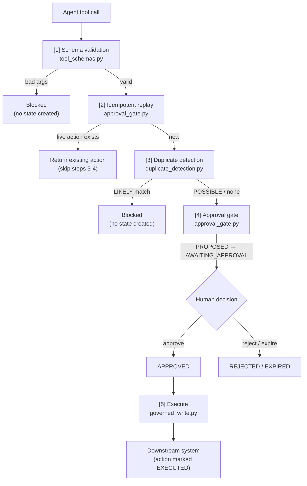

# governed-agent-toolkit

[](https://github.com/WaiteM124/governed-agent-toolkit/actions/workflows/ci.yml)

A reference implementation of the governance layer that sits between an AI
agent and a production write path. Every design choice here is about making
unsafe side-effects impossible without human sign-off — not inconvenient, but
impossible by construction.

```
python demo.py          # run the walkthrough
python -m pytest -v     # 32 tests, all green
```

---

## What it does

An LLM can call a write tool. That is a _proposal_, not a transaction. This
toolkit enforces a strict pipeline before anything touches a downstream system:



---

## Modules

### `approval_gate.py` — state machine

`ApprovalGateway` owns the lifecycle of every proposed write. States are
explicit; every transition is validated against an allow-list.

```
         propose()
  None ──────────► PROPOSED
                      │  request_approval()
                      ▼
              AWAITING_APPROVAL ──► EXPIRED  (deadline elapsed)
                 │       │
       approve   │       │  reject / withdraw
                 ▼       ▼
              APPROVED  REJECTED
                 │
         mark_executed()
                 ▼
              EXECUTED
```

Idempotency keys are computed as `sha256(actor_id:action_name:canonical_json(payload))`. Two calls with the same key return the same action. A rejected or expired action releases the key so a genuine retry opens a new decision; an executed action keeps the key so replays are deduplication-safe.

### `duplicate_detection.py` — fuzzy scorer

Before a "create" tool opens an approval, existing records are scored across
three field kinds:

| Kind | Similarity | Why |
|------|-----------|-----|
| `NAME` | rapidfuzz token-sort after legal-suffix removal | "Acme Ltd" == "ACME Limited" |
| `IDENTIFIER` | exact after normalising separators and case | fuzzy IDs collide too easily |
| `CONTACT` | exact email (typo tolerance ≥ 0.92) or last-7-digit phone | partial mailbox match is not a duplicate |

Results are bucketed:
- **POSSIBLE** — shown to the approver as review context.
- **LIKELY** — blocks the create outright; no approval is opened.

### `tool_schemas.py` — Pydantic contracts

Every write tool is a `ToolModel`. Unknown fields are rejected (`extra="forbid"`).
Key normalisation rules: email lowercased, phone stripped to `+` and digits,
tax codes uppercased, invoice amounts rejected if passed as IEEE floats (use
strings or integers to avoid binary rounding error).

### `governed_write.py` — composed write service

`GovernedWriteService` wires the three modules into the pipeline shown above.
`RecordStore` is an in-memory stand-in; a real service would swap it for a
database query. `IdempotentEchoExecutor` is the stand-in ERP/CRM client; it
returns a stable UUID for each `action_id` so a crash-and-retry is safe.

---

## Project Structure

```
approval_gate.py          State machine: propose → await → approve/reject → execute
duplicate_detection.py    Fuzzy scorer: NAME / IDENTIFIER / CONTACT field kinds
tool_schemas.py           Pydantic contracts for every write tool
governed_write.py         Composed pipeline: wires the three modules together
demo.py                   Walkthrough: six scenarios against an in-memory store
evals/
  cases/                  Adversarial + legitimate JSON cases
  runner.py               Eval gate: block/allow rates vs baseline
  baseline.json           CI floors (100% attack block; 100% legitimate allow)
tests/
  conftest.py             Shared fixtures (FrozenClock for deterministic time)
  test_approval_gate.py   State-machine edge cases and idempotency key behaviour
  test_duplicate_detection.py   Scorer accuracy, threshold logic, ranking
  test_tool_schemas.py    Normalisation rules and validation error shape
  test_governed_write.py  Full pipeline: schema → replay → dedupe → approve → execute
  test_evals.py           Eval-gate smoke coverage
```

---

## Install and run

```bash
pip install -e ".[dev]"
python demo.py
python -m pytest -v
python -m evals.runner    # adversarial eval gate; no API key
```

Requires Python 3.10+. No external services — everything is in-memory.

---

## Design decisions

**Self-approval guard.** The actor who proposed a write cannot approve it
(`SelfApprovalError`). They _can_ withdraw it (reject with `resolved_by ==
actor_id`), which is treated as a voluntary cancellation, not an authorisation.

**Idempotency key release on rejection.** REJECTED and EXPIRED are non-holding
states: the key is freed so a genuine retry starts a fresh decision cycle. This
matters when a person rejects because of bad data — the agent can fix the
payload and resubmit without being blocked by the old key. EXECUTED holds the
key forever, making replay detection permanent.

**Conflicting-identifier cap.** If a proposed record brings a `IDENTIFIER`-kind
field that doesn't match the stored one (e.g. two different account codes),
the scorer drops the identifier from the weighted average and caps confidence
just below the LIKELY threshold. The row is still surfaced for review without
auto-blocking: the second code could be a second site, or a typo only a person
can resolve.

**Schema errors create no governance state.** A malformed tool call returns a
blocked `Submission` immediately. The approval gateway never sees it. This keeps
the state machine clean and prevents an agent retry loop from filling the
gateway with junk.

**`or` vs `is None` for injected dependencies.** `ApprovalGateway` has
`__len__`, which makes an empty gateway falsy. `gateway or ApprovalGateway()`
would silently discard a valid injected gateway with zero actions (breaking
clock injection in tests). All optional constructor parameters use
`x if x is not None else default` to avoid this trap.

**Executor failure leaves the action APPROVED.** If the downstream call raises,
the action stays in APPROVED so a later `execute()` call retries it. The
executor is responsible for idempotency on its own side (keyed by `action_id`);
double-execution is safe.

---

## Limitations

This is a reference implementation with intentional simplifications:

- **In-memory only** — `RecordStore` and `ApprovalGateway` do not persist. A process restart loses all state.
- **No async support** — The pipeline is synchronous. A production path would need an async executor interface for non-blocking ERP calls.
- **Duplicate scorer is O(n)** — The scorer walks every existing record. A production master-data path would exact-lookup identifiers in an index first and only fuzzy-score the shortlist.
- **Single-tenant** — There is no concept of per-tenant record isolation or per-tenant approval policies.

## Production version would add

- **Persistent gateway** — PostgreSQL-backed `ApprovalGateway` with a `UNIQUE` constraint on `idempotency_key` and a background worker for `expire_stale()`.
- **Identifier index** — Pre-built index on `IDENTIFIER`-kind fields for sub-millisecond lookup before fuzzy scoring begins.
- **Async executor interface** — Non-blocking ERP/CRM calls with per-action timeout and dead-letter handling.
- **Webhook / notification layer** — Push an `AWAITING_APPROVAL` event to Slack or an approval UI rather than polling.
- **Multi-tenancy** — Per-tenant record stores and per-tenant threshold configuration.
- **Observability** — Structured logging and metrics on proposal rate, approval latency, block rate by reason, and duplicate hit rate.

---

## Contributing

Setup, tests, PR checklist, and agent rules: see [CONTRIBUTING.md](CONTRIBUTING.md) and [AGENTS.md](AGENTS.md). Decision records live in [docs/decisions/](docs/decisions/).

## License

MIT
